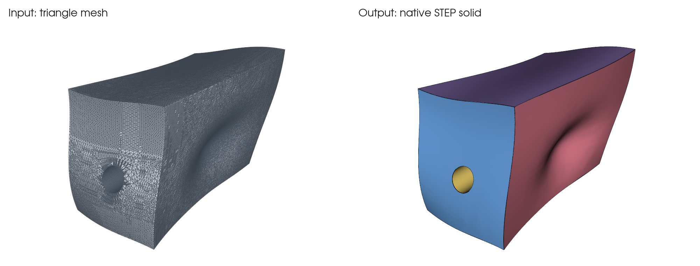

# guided-mesh-cad

**Turn freeform triangle meshes into native STEP and BRep solids, and measure how close the result is.**

A mesh reverse-engineering toolkit for people and LLM agents who already know how a part should be divided into surfaces. You supply the patch layout and any simplifications. The tool builds the solid, checks it against the source mesh, and writes the evidence to disk.

[中文说明](README.zh-CN.md)



Real output from the bundled `freeform` example, a synthetic part with six freeform faces and a skewed bore:

| | |
|---|---|
| Input | 96,948 triangles |
| Output | 1 solid, 7 faces, STEP and BRep |
| Largest sampled deviation | 0.0010 mm (tolerance 0.01 mm) |
| Samples checked | 53,833 mesh to model, 28,266 model to mesh |
| Reconstruction time | About 12 seconds on a Windows desktop |

The patch layout, a coarse construction mesh and the bore are all declared in the example's plan. They were not detected automatically.

## What it does

- **Rebuilds meshes as real CAD.** Handles several freeform patches in any orientation, with no need for a constant cross-section. Accepts NPZ meshes, BRep and STEP.
- **Leaves design intent to you.** Patches, functional interfaces and allowed simplifications come from the caller, so nothing is silently guessed.
- **Checks the result both ways.** Samples mesh to model and model to mesh against a tolerance, then records the worst points.
- **Resumes after interruptions.** Workflow plans keep checkpoints. `resume` reuses a finished step only if its inputs, code and outputs still match.
- **Keeps LLM context small.** Commands return short summaries. Full reports and logs stay on disk, and diagnostics are read in pages.

## Requirements

- Python 3.12 or later
- CadQuery 2.8.0 and VTK 9.6, installed automatically

Tested with CadQuery 2.8.0, OCP 7.9.3.1 and VTK 9.6.2 on Windows.

## Install

```bash
pip install git+https://github.com/Hyc-12138/guided-mesh-cad
```

## Use

Reproduce the example above:

```bash
python -m guided_mesh_cad example freeform --out input
python -m guided_mesh_cad reconstruct input/plan.json --out output
```

`output` then contains `model.step`, `model.brep`, `verification.json` and `manifest.json`.

Run a multi-step plan that can recover from interruptions:

```bash
python -m guided_mesh_cad example workflow --out demo-input
python -m guided_mesh_cad run demo-input/plan.json --out demo-run
python -m guided_mesh_cad status demo-run
python -m guided_mesh_cad resume demo-run
python -m guided_mesh_cad diagnose demo-run --task verify --view errors
```

Add `--full` to single-step commands such as `reconstruct` when you need the complete report on stdout.

More detail, in Chinese:

- [Run plans, resume and diagnostics](docs/workflows.md)
- [Capabilities, limits and test matrix](docs/dev23.md)
- [Reconstruction, surface and material APIs](docs/legacy_reference_dev22.md)

## Limits

- Experimental. Version 0.3.0.dev23, with no published release yet.
- It does not recognize design intent in an arbitrary mesh or recover the original CAD feature history.
- A pass means the sampled points met the tolerance. It is not a continuous proof, and it says nothing about materials, interference, motion or manufacturability.
- `repair_representation` for automatic repair of a complete BRep is not implemented. C0 diagnostics and B-spline domain limits do not replace topology repair.
- Native boolean warnings stay in the report. Finite point checks cannot waive them.
- Tests use synthetic inputs, so results cannot be extrapolated to arbitrary meshes. PDF and U3D decoders are not included.

## License

[Apache-2.0](LICENSE). See [NOTICE](NOTICE). Third-party dependencies keep their own licenses.
