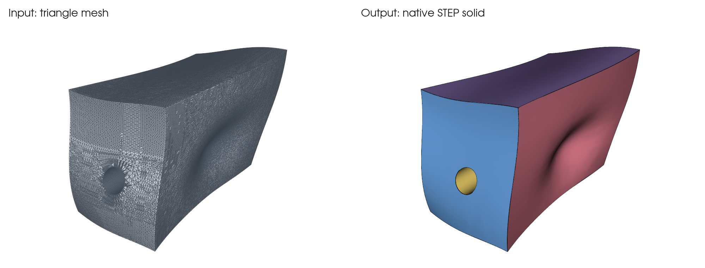

# guided-mesh-cad

**把自由曲面三角网格重建成原生 STEP、BRep 实体，并量出结果有多准。**

一套网格逆向工具，给已经知道零件该怎么分面的人和 LLM 智能体用。曲面分区和允许的简化由你提供，工具负责建实体、对照源网格检查，并把证据写到磁盘。

[English](README.md)



自带 `freeform` 示例的真实结果。它是一个合成零件，有六块自由曲面和一个斜孔：

| | |
|---|---|
| 输入 | 96,948 个三角面 |
| 输出 | 1 个实体、7 个面，STEP 和 BRep |
| 采样最大偏差 | 0.0010 mm（公差 0.01 mm） |
| 采样点数 | 网格到模型 53,833 个，模型到网格 28,266 个 |
| 重建耗时 | Windows 台式机上约 12 秒 |

分区、粗构造网格和斜孔都写在示例的计划里，不是工具自动识别出来的。

## 能做什么

- **重建成真正的 CAD**：可处理任意空间方向的多块自由曲面，不要求相同截面。输入支持 NPZ 网格、BRep、STEP。
- **设计意图由你决定**：曲面分区、功能界面和允许简化的范围都由调用者提供，工具不会暗中猜测。
- **双向检查结果**：按公差做网格到模型、模型到网格采样，并记录最差点。
- **中断后可恢复**：工作流计划带检查点，`resume` 只复用输入、代码和产物都仍然匹配的步骤。
- **节省 LLM 上下文**：命令默认返回短摘要，完整报告和日志留在磁盘，诊断分页读取。

## 环境

- Python 3.12 或更高
- CadQuery 2.8.0、VTK 9.6，安装时自动带上

测试环境：Windows，CadQuery 2.8.0、OCP 7.9.3.1、VTK 9.6.2。

## 安装

```bash
pip install git+https://github.com/Hyc-12138/guided-mesh-cad
```

## 使用

复现上面的示例：

```bash
python -m guided_mesh_cad example freeform --out input
python -m guided_mesh_cad reconstruct input/plan.json --out output
```

`output` 里会生成 `model.step`、`model.brep`、`verification.json` 和 `manifest.json`。

运行可从中断恢复的多步计划：

```bash
python -m guided_mesh_cad example workflow --out demo-input
python -m guided_mesh_cad run demo-input/plan.json --out demo-run
python -m guided_mesh_cad status demo-run
python -m guided_mesh_cad resume demo-run
python -m guided_mesh_cad diagnose demo-run --task verify --view errors
```

`reconstruct` 这类单步命令需要在标准输出看完整报告时，加 `--full`。

详细文档：

- [运行计划、恢复、按需诊断](docs/workflows.md)
- [本版能力、边界与验证矩阵](docs/dev23.md)
- [既有重建、曲面、材料检查接口](docs/legacy_reference_dev22.md)

## 限制

- 实验性项目，当前 0.3.0.dev23，还没有正式发布版。
- 不识别任意网格的设计意图，也不恢复原始 CAD 特征历史。
- 通过只说明采样点满足公差，不是连续证明，也不代表材料、干涉、运动或可制造性合格。
- 完整 BRep 的自动修复 `repair_representation` 尚未实现；C0 诊断和 B-spline 参数域限制不替代拓扑修复。
- 原生布尔警告保留在报告里，不能用有限点检查豁免。
- 测试使用合成输入，结果不能外推到任意网格。不包含 PDF、U3D 解码器。

## 许可

[Apache-2.0](LICENSE)，见 [NOTICE](NOTICE)。第三方依赖保留各自许可证。
